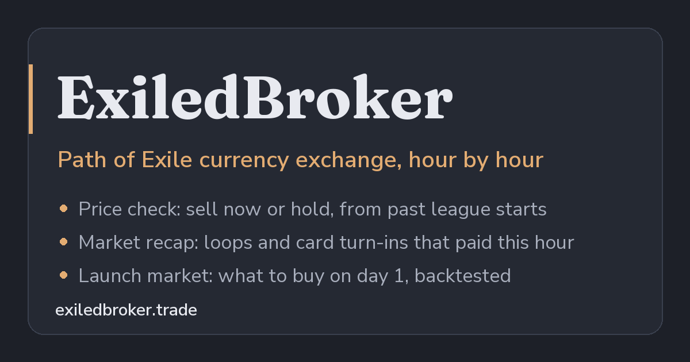

# ExiledBroker

ExiledBroker is a market tool for the first two weeks of a Path of Exile league. Every few months the game resets its economy, and for a fortnight prices move fast and predictably: ExiledBroker reads the game's hourly currency-exchange history, learns how prices moved after past launches, and tells a trader what to buy on day one, when to sell, and which trades paid in the last hour.

It is built for players who trade seriously at league start and want numbers rather than folklore, and every recommendation is checked against what would actually have happened.



## What it does

- **Market recap** (the landing page). What traded in the latest published hour: volatile items worth flipping, currency loops (Chaos to an item to Divines and back) and divination-card turn-ins that paid, ranked by how often the same orders actually went through over the last three days.
- **Price check.** One item at a time: its price this league in Chaos and Divines, a sell-now or hold verdict for the next day and the next three days drawn from past leagues' price paths, the best hour of the day to sell, and how long a stack takes the market to absorb.
- **Launch market.** What to buy on day one, on days two to four and on days five to ten with a few Divines, ranked from the last five leagues.
- **Research.** The project's findings as a readable journal, how each tool works, and a backtest that answers the obvious question: would following the site have made money?

## The problem

A new league starts with an empty economy, so the useful question is not "what is this worth" but "where will it be in a week". The answer is in past leagues: Grinding Gear Games publishes every hour of its currency exchange, and poe.ninja publishes daily prices for every league since 2016. The raw data is about ten million rows across 32 leagues, though, with gaps, renames and thin markets that produce misleading prices. ExiledBroker turns it into a few decisions a player can act on in the middle of a busy launch day.

## Key design ideas

**It runs on a $5 hosting plan.** The site's work happens once an hour, when the game publishes a new hour of data. A pipeline loads the hour and precomputes every page's default view; the API then serves those views from memory, gzipped once and tagged so browsers and the CDN can reuse them, and a visitor's browser asks the server for new data only when a new hour is due. Simulated with the hosting provider's own billing rates, the whole site (web server, database, hourly pipeline) comes to $2.72 of usage a month at 10 daily visitors, $3.73 at 100 and an estimated $4.90 at 1,000. Performance budgets in the test suite fail a change that reads more than its page needs.

**Usage is counted without cookies.** The site needs to know which pages people use, but not who they are. Visits are counted with a hashed identifier under a monthly salt that is then deleted; no IP address and nothing on the visitor's device is stored, so no consent banner is needed. [Usage counts](docs/usage.md) explains the reasoning.

**Uncertain rewards are priced at their worst case.** Some divination cards pay out a random item from a pool ("5x Fossil"). The game doesn't publish the odds, so instead of guessing an average, a card is valued at the cheapest thing it can roll. If a set still costs less than that floor, the trade pays whatever drops.

**The backtest asks whether the order would have filled.** It is easy to make an arbitrage tool look profitable by assuming every trade happens at the average price. ExiledBroker's backtest replays the site's own advice an hour late, as a player would see it, in the whole-number lots the exchange accepts, at fair prices and at harsh ones near the worst traded, and counts an order only if the market actually traded through it. The result is honest: the launch-day picks returned 1.2 to 3.5 times their stake in Divines in every league tested even at the worst prices, while the hourly loops and card turn-ins at best break even. The site says so on the page.

**It is polite to its data sources.** Each exchange hour is immutable, so it is fetched once, ever. Every request goes through one rate-limited client, one at a time, and reference data uses conditional requests. Being blocked by either source would end the project.

## How it's built

A Python pipeline fetches the data, normalises it into DuckDB for research and Postgres for the site, and precomputes each page's views every hour; a FastAPI service serves them to a React frontend. It is set up to run on Railway behind Cloudflare, with an off-site backup on Supabase's free tier.

**Stack:** Python, polars, DuckDB, Postgres, FastAPI, pydantic, React, TypeScript, Vite, TanStack Query, ECharts, Tailwind, Docker.

## Status

Built and tested end to end, and designed and simulated for launch-day load, but not yet deployed. It will go live ahead of the next league, which launches in about a month. Progress by phase and the next steps are in the [roadmap](docs/roadmap.md).

## Further reading

- [Architecture](docs/architecture.md): the data flow, the pages and their endpoints, the code layout.
- [Findings](docs/findings.md): what the data says about league launches, from the backtest to the best hour to sell.
- [Hosting and performance](docs/hosting.md): the cost model, the simulated bill and every performance issue found.
- [Data](docs/data.md): the sources and how raw exchange hours become prices.
- [Security and abuse](docs/security.md): the layers in front of the API and the remaining risks.
- [Decision log](docs/decisions.md): every design decision, dated, with its reasoning.
- [Going live](docs/go-live.md): the launch checklist and the rollback plan.

## Quick start

Python 3.11+ and Node 24.

```bash
python3 -m venv .venv && .venv/bin/pip install -e '.[dev,pg]'
.venv/bin/eb init-db && .venv/bin/eb dumps sync && .venv/bin/eb dumps load   # daily history
.venv/bin/eb serve                        # API at http://127.0.0.1:8000/api
cd web && npm install && npm run dev      # site at http://localhost:5173
.venv/bin/pytest                          # tests
```

The full setup, including the hourly exchange and the hosted stack in Docker, is in [Architecture](docs/architecture.md#running-it-locally).

## Credits and license

Daily price history comes from [poe.ninja](https://poe.ninja), whose economy dumps are published under [CC BY-SA](https://creativecommons.org/licenses/by-sa/3.0/). Hourly currency-exchange history comes from Grinding Gear Games' public API, and item names from [RePoE](https://github.com/repoe-fork/repoe). ExiledBroker is not affiliated with or endorsed by Grinding Gear Games or poe.ninja.

MIT licensed. See [LICENSE](LICENSE).
